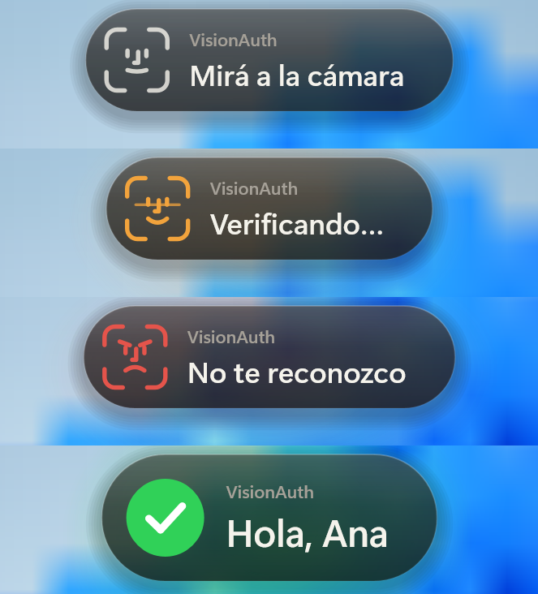

<p align="center"></p>

# VisionAuth

Un "Face ID" para Windows: te sentás frente a la PC bloqueada, la webcam te
reconoce y entra sola, sin escribir la contraseña ni el PIN. Funciona con una
webcam común (RGB), sin cámara infrarroja.

<p align="center"></p>

Mientras la PC está bloqueada, una "isla" arriba de la pantalla de inicio de
sesión muestra qué está pasando: buscando tu cara, verificando, si no te
reconoce y, al reconocerte, te saluda por tu nombre y entra.

> **Comodidad antes que seguridad.** Con una webcam común, una foto o un video
> tuyo bien hechos podrían llegar a desbloquear la PC. VisionAuth no reemplaza
> a Windows Hello con cámara infrarroja. Leé [qué protege y qué no](docs/seguridad.md)
> antes de instalarlo.

## Qué hace

- Desbloquea tu cuenta de Windows cuando reconoce una cara registrada: al
  bloquear con Win+L y al volver del reposo.
- Varias caras pueden desbloquear la misma cuenta; cada una es saludada por
  su nombre.
- Espera a que la pantalla se vea antes de entrar (al despertar la PC).
- Si no hay nadie frente a la cámara, queda en espera, en gris.
- El PIN y la contraseña siguen funcionando siempre, como alternativa.
- Un menú en PowerShell para administrar caras, la contraseña guardada y los
  ajustes.

## Requisitos

- Windows 11 o Windows 10, con permisos de administrador.
- Una webcam.
- Una cuenta de Windows con contraseña. Para una cuenta de Microsoft, la
  contraseña de Microsoft (el PIN no alcanza).
- Python 3.12 o más nuevo, Git y el compilador WinLibs (MinGW-w64). La
  [guía de instalación](docs/instalacion.md) explica cómo instalarlos.

## Instalación rápida

Si ya tenés Python, Git y WinLibs:

```powershell
git clone https://github.com/zaccone21/VisionAuth.git
cd VisionAuth
python -m pip install --user -e ".[dev]"
python scripts\download_models.py
& "C:\Program Files\Git\bin\sh.exe" credential_provider/build.sh
# En PowerShell como administrador:
.\scripts\install.ps1 -SkipLockScreen
```

El instalador registra tu cara si todavía no hay ninguna y te pide la
contraseña de la cuenta. Después, bloqueá con Win+L y mirá a la cámara.

El paso a paso completo, con cada requisito, está en
[docs/instalacion.md](docs/instalacion.md).

## Administrarlo

```powershell
.\visionauth.ps1
```

Abre el menú para agregar, renombrar o eliminar caras, cambiar la contraseña
guardada, la cámara, la sensibilidad y los demás ajustes, pausar VisionAuth
o ver el log. Ver [docs/uso.md](docs/uso.md).

## Documentación

| Documento | Contenido |
|---|---|
| [Instalación](docs/instalacion.md) | Paso a paso desde cero |
| [Uso](docs/uso.md) | El menú y los comandos |
| [Configuración](docs/configuracion.md) | Ajustes, archivos y registro |
| [Seguridad](docs/seguridad.md) | Qué protege y qué no |
| [Recuperación](docs/recuperacion.md) | Si la pantalla de inicio falla, y cómo desinstalar |
| [Desarrollo](docs/desarrollo/README.md) | Cómo está hecho, tests y decisiones de diseño |

## Licencia

MIT, ver [LICENSE](LICENSE). Se entrega sin garantía: si algo falla, el PIN
sigue disponible y [la guía de recuperación](docs/recuperacion.md) explica
cómo sacarlo.
